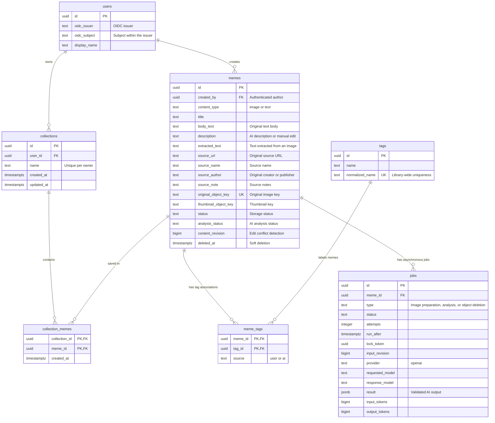

# Memehub Database Schema

## Scope and Conventions

- Use PostgreSQL. Store image files in S3-compatible storage and text meme bodies in the database.
- Use OpenAI models for AI analysis. Select the model through server configuration and record the model used for each job.
- This document is a design proposal. It does not create a database or run migrations.
- Identify users through OIDC login. Anonymous uploads are not supported. Memes and tags belong to one shared library, with an author recorded for each meme.
- The first version supports image and text memes, source attribution, AI analysis, manual editing, and text and tag search. Video, semantic search, and public sharing features are outside this schema's scope.
- Use server-generated UUIDs for primary keys.
- Store timestamps as `timestamptz`. Default `created_at` and `updated_at` to `now()`. The server updates `updated_at` on changes.
- Fields are `NOT NULL` unless stated otherwise. Use `text` columns with `CHECK` constraints for the status values below.

## Table Relationships

User collections are implemented by `20261102150000_collections.sql`:

- `collections(id uuid PK, user_id uuid FK users ON DELETE CASCADE, name text, created_at timestamptz, updated_at timestamptz)`. Names contain 1–100 Unicode characters, are trimmed and NFC-normalized by the server, and are unique per owner. The owner comes from the authenticated session.
- `collection_memes(collection_id uuid FK collections ON DELETE CASCADE, meme_id uuid FK memes ON DELETE CASCADE, created_at timestamptz)` uses `(collection_id, meme_id)` as its primary key. A meme can belong to multiple collections, and saving never changes the original author or creates another image object.
- Only the owner may list, inspect, rename, delete, or change a collection, including when the caller is an administrator. Mutations reuse session, Origin, and CSRF validation. Removing a collection or membership does not delete the meme.
- List and membership counts include only ready, non-deleted memes. Soft-deleted originals disappear from collections immediately; image cleanup retains its existing behavior. Collections are private; their original memes remain part of the shared library.
- Indexes cover `(user_id, created_at DESC, id DESC)` and reverse membership lookup by `meme_id`. Collection lists and filtered meme lists use cursor pagination. `GET /api/memes?collection=<uuid>` combines collection ownership with existing search, tag, author, and content-type filters.

The diagram shows key fields and relationships. The tables below define the complete fields and constraints. `PK` means primary key; `FK` means foreign key.

## 1. users — OIDC Users

| Field | Type | Nullable | Default | Description |
|---|---|---|---|---|
| id | uuid | No | Server-generated | Internal user primary key |
| oidc_issuer | text | No | None | `iss` from the validated ID token |
| oidc_subject | text | No | None | `sub` from the validated ID token |
| display_name | text | Yes | NULL | Display name; never used for identity or authorization |
| created_at | timestamptz | No | now() | First login time |
| updated_at | timestamptz | No | now() | User information update time |

Constraints and processing rules:

- `UNIQUE (oidc_issuer, oidc_subject)`. Identify a user by this pair. Neither field is individually unique.
- Reject empty identifiers and preserve the exact values issued by the provider. Do not lowercase them or normalize the issuer URL again.
- Create or look up users only from validated OIDC login results. Do not trust `iss`, `sub`, or user IDs supplied in a request body.
- Do not automatically link accounts with different issuers or subjects, even if their email addresses match.
- Do not store passwords, raw ID tokens, or provider access or refresh tokens in this table. The first version stores only information needed to identify a login.
- Linking multiple OIDC accounts to one internal user is outside scope.

## 2. memes — Image and Text Memes with Source Attribution

| Field | Type | Nullable | Default | Description |
|---|---|---|---|---|
| id | uuid | No | Server-generated | Primary key |
| created_by | uuid | No | None | Author; references `users.id` |
| content_type | text | No | None | Meme type: `image` or `text` |
| title | text | No | Empty string | Editable title; an image meme may initially use its filename |
| body_text | text | Yes | NULL | Original text meme body; preserve line breaks and display as plain text |
| description | text | No | Empty string | Editable description; may initially be filled from AI output |
| extracted_text | text | No | Empty string | Text extracted from an image; editable by the user |
| source_url | text | Yes | NULL | Original post or page URL for either meme type |
| source_name | text | Yes | NULL | Source name, such as a website, community, or book title |
| source_author | text | Yes | NULL | Original creator or publisher name |
| source_note | text | Yes | NULL | Additional attribution, such as a page number or how the meme was received |
| original_filename | text | Yes | NULL | Uploaded image filename; NULL for text memes |
| original_object_key | text | Yes | NULL | Original image S3 object key; NULL for text memes |
| thumbnail_object_key | text | Yes | NULL | Thumbnail S3 object key |
| mime_type | text | Yes | NULL | Server-verified file type; NULL before upload verification |
| size_bytes | bigint | Yes | NULL | Server-verified file size |
| width | integer | Yes | NULL | Image width in pixels |
| height | integer | Yes | NULL | Image height in pixels |
| sha256 | text | Yes | NULL | Original file SHA-256 hash, used to indicate duplicate images |
| status | text | No | None | Storage status; `uploading` for new images, `ready` for new text memes |
| analysis_status | text | No | not_requested | AI analysis status |
| content_revision | bigint | No | 0 | Incremented when title, body, description, extracted text, attribution, or tags change |
| created_at | timestamptz | No | now() | Meme creation request time |
| updated_at | timestamptz | No | now() | Update time |
| deleted_at | timestamptz | Yes | NULL | Deletion request time; non-NULL rows are excluded from listings and search |

Constraints:

- Use `ON DELETE RESTRICT` for the `created_by` foreign key. The server sets the author from the login session at creation; ordinary updates cannot change it.
- `content_type` must be `image` or `text`. Changing the type after creation is not supported.
- `UNIQUE (original_object_key)`. The server generates object keys. PostgreSQL's default unique constraint allows multiple NULL values.
- Image memes require `original_filename` and `original_object_key`; `body_text` must be NULL.
- Text memes require a non-blank `body_text`. Check for whitespace-only input while preserving the stored original line breaks.
- For text memes, all file fields (`original_filename`, `original_object_key`, `thumbnail_object_key`, `mime_type`, `size_bytes`, `width`, `height`, `sha256`) must be NULL, `extracted_text` must be empty, and `status` must be `ready`.
- Enforce the type-specific required and NULL rules above with `CHECK` constraints.
- `status` must be one of `uploading`, `processing`, `ready`, or `failed`.
- `analysis_status` must be one of `not_requested`, `queued`, `processing`, `completed`, or `failed`.
- `size_bytes`, `width`, and `height` must be greater than zero when present.
- `content_revision >= 0`.
- When present, `sha256` must contain exactly 64 lowercase hexadecimal characters. Do not use a unique constraint to block duplicate uploads.
- Image memes in `ready` status require verified `mime_type`, `size_bytes`, `width`, `height`, and `sha256` values.
- Source fields are optional. Store empty inputs as NULL. A source name or note may be recorded without a URL.
- Parse `source_url` on the server and allow only `http` and `https`. Do not make source URLs unique; multiple memes may come from one post.

Processing rules:

- Verify the actual object and file type on the server rather than trusting the upload completion request alone.
- Separate storage status from AI analysis status. Users can open or copy valid images and text even if analysis fails.
- Do not store S3 access URLs or temporary signed URLs. Generate access URLs from object keys.
- Increment `content_revision` when the user changes content. Record that value when creating an AI job.
- AI suggests descriptions and tags. It must not overwrite `body_text` or user-entered source information.
- Present attribution as user-entered information. Do not treat AI guesses about sources or creators as confirmed attribution.
- Store source URLs as links. Do not automatically fetch pages or download their images.

## 3. tags — Tags

| Field | Type | Nullable | Default | Description |
|---|---|---|---|---|
| id | uuid | No | Server-generated | Primary key |
| name | text | No | None | Display name |
| normalized_name | text | No | None | Name used for duplicate detection |
| created_at | timestamptz | No | now() | Creation time |
| updated_at | timestamptz | No | now() | Update time |

Constraints:

- `UNIQUE (normalized_name)`. Store one tag per normalized name across the entire library.
- Reject empty `name` and `normalized_name` values.
- Build `normalized_name` on the server by trimming surrounding whitespace, applying Unicode NFC normalization, and lowercasing English letters.
- Tag names are shared across the library. Meme authors can attach or detach tags; the first version does not expose APIs to rename or delete shared tags.

## 4. meme_tags — Meme and Tag Associations

| Field | Type | Nullable | Default | Description |
|---|---|---|---|---|
| meme_id | uuid | No | None | References `memes.id` |
| tag_id | uuid | No | None | References `tags.id` |
| source | text | No | None | Association origin: `user` for manual entry, `ai` for an AI suggestion |
| created_at | timestamptz | No | now() | Association time |

Constraints and processing rules:

- Use `(meme_id, tag_id)` as the primary key.
- Apply `ON DELETE CASCADE` to both foreign keys.
- Set `source = user` when a user explicitly confirms an AI tag.
- Reanalysis must not delete or overwrite user tags.
- Removing an AI tag increments the meme's `content_revision`. Do not automatically apply an in-flight analysis result. Later reanalysis also provides suggestions only.

## 5. jobs — Asynchronous Jobs and OpenAI Analysis Records

| Field | Type | Nullable | Default | Description |
|---|---|---|---|---|
| id | uuid | No | Server-generated | Primary key |
| meme_id | uuid | No | None | Target meme; references `memes.id` |
| type | text | No | None | One of `prepare_image`, `analyze_content`, or `delete_objects` |
| status | text | No | queued | One of `queued`, `processing`, `completed`, or `failed` |
| attempts | integer | No | 0 | Number of execution attempts started |
| max_attempts | integer | No | 3 | Maximum execution attempts |
| run_after | timestamptz | No | now() | Earliest next execution time |
| locked_until | timestamptz | Yes | NULL | Job lease expiration time |
| lock_token | uuid | Yes | NULL | Current worker's lease token |
| started_at | timestamptz | Yes | NULL | Most recent execution start time |
| finished_at | timestamptz | Yes | NULL | Completion or final failure time |
| input_revision | bigint | Yes | NULL | Meme `content_revision` when the AI job was created |
| provider | text | Yes | NULL | `openai` for AI jobs |
| requested_model | text | Yes | NULL | OpenAI model name used in the request |
| response_model | text | Yes | NULL | Actual model name recorded in the response |
| prompt_version | text | Yes | NULL | Prompt and output schema version |
| provider_request_id | text | Yes | NULL | Request identifier returned by OpenAI |
| result | jsonb | Yes | NULL | Validated AI output: title, description, tags, and extracted text for images |
| input_tokens | bigint | Yes | NULL | Input token count reported by the provider |
| output_tokens | bigint | Yes | NULL | Output token count reported by the provider |
| error_code | text | Yes | NULL | Error code with secrets excluded |
| created_at | timestamptz | No | now() | Creation time |
| updated_at | timestamptz | No | now() | Update time |

Constraints:

- Use `ON DELETE RESTRICT` for the `meme_id` foreign key to prevent removing the meme row before object deletion finishes.
- `attempts >= 0` and `max_attempts > 0`.
- Token counts and `input_revision` must be non-negative when present.
- `analyze_content` jobs require `provider = openai`, `requested_model`, `prompt_version`, and `input_revision`.
- Create `prepare_image` and `delete_objects` jobs only for image memes. Validate the meme type on the server when creating a job.
- `analyze_content` supports both image and text memes. Supply image input for images and `body_text` for text. The selected model must support the corresponding input format.
- `processing` status requires `locked_until` and `lock_token`.
- Allow at most one `queued` or `processing` job per meme and job type. Enforce this with a partial unique index.

Processing rules:

1. Claim jobs in a transaction using `FOR UPDATE SKIP LOCKED`.
2. Issue a lease token, increment attempts, and commit the transaction. Do not hold a database lock during an OpenAI request.
3. Extend the lease for long-running jobs. Another worker may reclaim an expired job.
4. Verify the lease token when saving results. Reject late results from an earlier worker.
5. Retry transient errors with increasing delays. Set `failed` when the maximum number of attempts is reached.
6. Request AI output in the defined JSON format and validate it on the server. Do not store the entire raw response.
7. Automatically apply the first AI result only when `input_revision` still matches and the meme is not deleted. Apply the result and complete the job in one transaction.
8. Increment `content_revision` when applying a result. Keep reanalysis results and conflicting results in `result` for the user to apply explicitly.
9. Retries may cause duplicate OpenAI calls. Prevent duplicate database application; duplicate external request costs cannot be ruled out.
10. Read API keys from environment variables or a secret store. Never record them in the database or error messages.
11. Analysis input must match the recorded `input_revision`. Read body or image information together with the revision immediately before the call. If already changed, update the job to the latest revision before execution. Check for conflicts again when applying results.
12. After a text body edit, do not treat previous analysis as current. If no analysis job is active, set `analysis_status = not_requested`. If a job is active, detect the revision conflict on completion, skip automatic application, and set `not_requested`. Keep its result in job history.

## Query Indexes

| Table | Index | Purpose |
|---|---|---|
| users | Unique `(oidc_issuer, oidc_subject)` | OIDC user lookup and duplicate prevention |
| memes | `(created_at DESC, id DESC) WHERE deleted_at IS NULL AND status = 'ready'` | Latest-first listings and cursor pagination |
| memes | `(created_by, created_at DESC, id DESC) WHERE deleted_at IS NULL` | Author's memes and author foreign key lookup |
| memes | `(sha256) WHERE deleted_at IS NULL AND sha256 IS NOT NULL` | Duplicate file detection within the library |
| tags | Unique `(normalized_name)` | Tag uniqueness and name lookup |
| meme_tags | `(tag_id, meme_id)` | Search memes by tag |
| jobs | `(run_after, id) WHERE status = 'queued'` | Runnable job lookup |
| jobs | `(locked_until) WHERE status = 'processing'` | Expired lease lookup |
| jobs | Unique `(meme_id, type) WHERE status IN ('queued', 'processing')` | Prevent duplicate active jobs |
| jobs | `(meme_id, created_at DESC)` | Job history for a meme |

PostgreSQL automatically creates indexes for primary keys and unique constraints. Do not create duplicates.

## OIDC Login and Authorization

- Handle Authorization Code Flow with PKCE on the Go server. Generate `state` and `nonce` at login initiation and validate them on callback.
- Accept only OIDC issuers registered in server configuration. Before identifying a user, validate the ID token signature, allowed algorithm, `iss`, `aud`, expiration, `nonce`, and applicable `azp` conditions.
- Issue a service session after successful login. Use `HttpOnly`, `Secure`, `SameSite=Lax` cookies. Apply CSRF protection to cookie-authenticated mutation requests.
- Manage service sessions in a server-side session store. Provider tokens in the user table must not substitute for service sessions. Select the store and lifetime before implementation.
- Proposed default permissions: valid stored memes are readable and searchable without login. Image uploads and text creation require login.
- For edits, deletion, upload completion, reanalysis requests, applying AI suggestions, and tag association changes, verify on the server that `memes.created_by` matches the logged-in user ID.
- Apply author checks when issuing upload URLs and retrieving incomplete uploads. Expose failure or processing details and AI job results only to the author.
- Internal workers prepare images and apply AI results. Clients cannot directly write job statuses or analysis results.
- `source_author` identifies the original creator; `created_by` identifies the person who submitted the meme to this service. Keep them separate.

## Search Implementation

- Listings and search cover the shared library, excluding deleted memes and memes that are not ready.
- Search `title`, `body_text`, `description`, `extracted_text`, `source_name`, `source_author`, and tag names by default.
- Filter by `content_type` to show all memes, images only, or text only.
- Apply tag filters through `meme_tags`. When multiple tags are selected, require all selected tags.
- Escape search terms for substring matching. Do not interpret user-entered `%` or `_` as pattern operators.
- Consider a `pg_trgm` GIN index on a combined expression of title, body, description, extracted text, source name, and source author. Use `coalesce` for nullable fields and the same expression in queries.
- Finalize indexes after checking search results and execution plans for Korean text, short queries, and OCR errors.
- Design OpenAI embeddings and `pgvector` separately when implementing semantic search.

## Creation and Deletion Flows

### Image Upload

1. Set `created_by` from the logged-in user ID and create a row with `content_type = image` and `status = uploading`. Save supplied attribution and issue an upload URL for the object key.
2. Once upload completion is verified, set `processing` and create a `prepare_image` job in the same transaction.
3. After file type and size validation and thumbnail generation, set `ready`. Create an `analyze_content` job and set `analysis_status = queued` in the same transaction.
4. If file verification fails, set `failed` without creating an analysis job.
5. Clean up incomplete uploads that remain after their upload URLs expire. Configure the exact retention period at deployment.

### Text Creation

1. Verify that the body is not blank. Do not interpret it as HTML.
2. Set `created_by` from the logged-in user ID and save the body and optional title and attribution with `content_type = text` and `status = ready`. Skip file upload and thumbnail generation.
3. Create an `analyze_content` job and set `analysis_status = queued` in the same transaction. OpenAI suggests descriptions and tags while preserving the original body.
4. Show the meme in listings and search immediately after saving, without waiting for AI analysis.
5. Support body copying for text memes and original downloads and image copying for image memes.

### Deletion

1. For image memes, set `deleted_at` and create a `delete_objects` job in the same transaction. For text memes, set `deleted_at` without creating an S3 deletion job.
2. Workers delete original images and thumbnails. Treat already missing objects as successful deletions.
3. Skip queued work for deleted memes. Do not apply in-flight analysis results to them.
4. If image preparation overlaps a deletion request, clean up objects produced by that work afterward. Derive object keys predictably from the meme ID. Perform the deletion job's final check after image preparation finishes or its lease expires.
5. The first version retains soft-deleted meme rows and job history. Decide the retention period for permanent deletion separately.

## Settings to Finalize Before Implementation

Use the environment variable names and proposed starting values in [PROJECT.md](PROJECT.md) and [.env.example](.env.example). Confirm the following when selecting providers and operating policies:

- OIDC provider, issuer URL, client ID, client secret, and allowed redirect URI. Keep secret values in server secret configuration, never in documentation or database records.
- Service session store, session lifetime, and session invalidation on logout.
- Whether to accept the proposed unauthenticated read policy.
- Allowed image formats, maximum file size, and animated GIF support.
- Maximum lengths for text bodies, titles, and source fields.
- OpenAI model, call concurrency, and cost limits.
- Policy for sending images and text to OpenAI, and validity periods for S3 image access URLs.
- Retention periods for incomplete uploads and deletion history.
